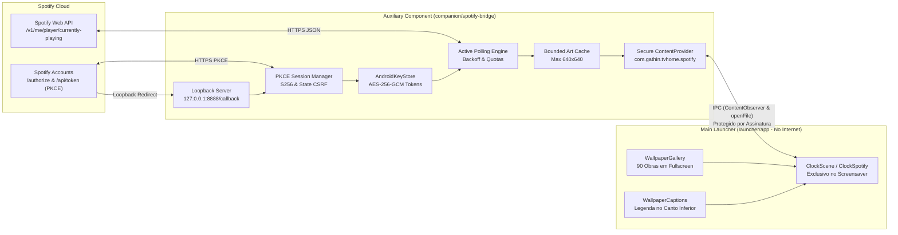

# Reimagui: Contrato e Arquitetura Spotify Now Playing

Especificação de arquitetura, modelo de segurança e contrato IPC para integração do
Spotify Now Playing exclusivamente na tela de relógio/screensaver do CleanYourTV (Reimagui R3).

## 1. Princípios e Fronteiras Arquiteturais

1. **Zero Internet no Launcher**: O pacote principal `com.gathin.tvhome` mantém estritamente
   zero permissões de rede (sem `android.permission.INTERNET`).
2. **Componente Auxiliar Separado (`companion/spotify-bridge`)**: Uma aplicação Android independente
   que gere a autenticação OAuth 2.0 PKCE, consultas HTTPS à Spotify Web API e cache local da capa.
3. **Exclusividade no Relógio**: O Spotify Now Playing é apresentado apenas no `ClockScene`
   (`ClockActivity` / `ClockDream`), preservando a galeria de pinturas de fundo e as legendas.
   **Nenhum código ou elemento Spotify existe na tela inicial (`MainActivity`).**
4. **Sem Painel Preto Sólido**: A interface do Now Playing é flutuante e transparente,
   com sombras no texto e capa destacada, permitindo a visualização da pintura ao fundo.
5. **Multi-dispositivo (Conta do Utilizador)**: A Web API do Spotify (`/v1/me/player/currently-playing`)
   reflete o estado da conta quer a música esteja a tocar na própria TV, no telemóvel, computador ou coluna.
6. **Segurança de Credenciais**:
   - **Zero Client Secret**: O fluxo utiliza Authorization Code com PKCE (RFC 7636). Nenhum segredo
     de cliente é embutido no APK nem no repositório.
   - **Encriptação via AndroidKeyStore**: Tokens protegidos por AES-256-GCM com chaves geradas
     no `AndroidKeyStore`, nunca em SharedPreferences em texto claro.
   - **Zero Tokens no Git**: Tokens residem unicamente no armazenamento privado encriptado
     do componente auxiliar na TV, nunca exportados nem partilhados via IPC.

## 2. Modelo de Autenticação PKCE (RFC 7636) e Loopback (RFC 8252)

Em conformidade com as regras oficiais do Spotify Developer para aplicações nativas:

1. **Redirect URI Loopback (RFC 8252 Sec. 7.3)**:
   - URI oficial registada: `http://127.0.0.1:8888/callback`.
   - O bridge executa um `SpotifyLoopbackServer` interno, escutando exclusivamente em `127.0.0.1:8888`
     (rejeitando qualquer tráfego não-loopback), que acolhe o redirect do browser, extrai `code` e `state`,
     emite resposta HTML amigável e encerra a conexão de imediato.
2. **Geração do Verificador (`code_verifier`) e Desafio (`code_challenge`)**:
   - `code_verifier`: string criptograficamente aleatória com 64 caracteres (`[A-Za-z0-9-._~]`).
   - `code_challenge`: `BASE64URL_NOPADDING(SHA256(ASCII(code_verifier)))` com método `S256`.
   - Validado com 100% de conformidade contra o vetor de teste do RFC 7636 Apêndice B.
3. **Mitigação CSRF via `state` e Uso Único (Single-Use)**:
   - `state`: 32 caracteres aleatórios de alta entropia gerados por sessão.
   - `SpotifyAuthSession` valida obrigatoriamente a coincidência de `state` no retorno.
   - O `code_verifier` é descartado da memória imediatamente após a troca do token, impedindo reutilização.
   - Sessões não concluídas expiram em 5 minutos.
4. **Troca e Renovação**:
   - POST para `https://accounts.spotify.com/api/token` com `code_verifier` e sem Client Secret.
   - Renovação transparente em HTTP 401 ou token expirado (`isExpired()`) com antecedência de 60s.

## 3. Armazenamento Encriptado via AndroidKeyStore

- Chave mestra AES-256 gerada pelo hardware de segurança ou `AndroidKeyStore` (`SpotifyTokenKey`).
- Encriptação de `access_token` e `refresh_token` em modo `AES/GCM/NoPadding` com IV aleatório de 12 bytes.
- Os ficheiros locais guardam apenas o par `Base64(IV):Base64(Ciphertext)`. Em caso de corrupção ou revogação,
  o conteúdo decifra para nulo e a sessão é limpa de forma segura.

## 4. Contrato de Comunicação IPC e Segurança do ContentProvider

A comunicação entre o Launcher e o componente auxiliar é feita através de um `ContentProvider` Android
com permissão mútua de assinatura (`android:protectionLevel="signature"`).

### 4.1 Autoridade e URIs

- **Authority**: `com.gathin.tvhome.spotify`
- **URI de Metadados**: `content://com.gathin.tvhome.spotify/now_playing`
- **URI da Capa**: `content://com.gathin.tvhome.spotify/art`

### 4.2 Verificação de Identidade do Consumidor

O provider verifica em cada invocação (`query`, `openFile`, `call`):
1. Pacote chamador (`getCallingPackage()`): autoriza chamadas diretas de `com.gathin.tvhome`.
2. Correspondência de assinatura (`checkSignatures`): rejeita chamadores terceiros com `SecurityException`.

### 4.3 Tabela de Metadados (`now_playing`)

Cursor de linha única com dados estritamente de apresentação. **Zero tokens ou credenciais no esquema**:

| Coluna | Tipo | Descrição |
|---|---|---|
| `is_playing` | `INTEGER` | `1` se estiver em reprodução ativa; `0` se pausado ou inativo |
| `track_title` | `TEXT` | Nome da faixa musical |
| `artist_name` | `TEXT` | Nome do artista principal ou artistas |
| `album_name` | `TEXT` | Nome do álbum |
| `duration_ms` | `INTEGER` | Duração total da música em ms |
| `progress_ms` | `INTEGER` | Posição atual da reprodução em ms |
| `art_uri` | `TEXT` | URI para leitura da capa (`content://com.gathin.tvhome.spotify/art`) |
| `updated_at` | `INTEGER` | Timestamp local (`System.currentTimeMillis()`) da última atualização |

### 4.4 Acesso Seguro às Capas (`openFile`)

- **Modo Estritamente Somente Leitura**: Rejeita qualquer modo que não seja `"r"` (`SecurityException`).
- **Validação de Caminho Canónico**: Garante que o ficheiro resolvido está estritamente dentro de `cacheDir/now_playing_art.png`, impedindo ataques de *Path Traversal*.
- **Streaming por `ParcelFileDescriptor`**: Decodificação direta no processo do launcher via `openFileDescriptor`, sem passar bitmaps pesados pelo Binder IPC.

### 4.5 Proteção do Modo Mock

- **Desligado por Defeito (`mockMode = false`)**: Em produção, se não houver reprodução real de Spotify, o provider devolve sempre `is_playing = 0` e valores vazios.
- Falsas faixas simuladas nunca são exibidas como reprodução real na TV.
- A simulação só é ativada em testes controlados através de métodos explícitos de teste (`enableMockForTesting`).

## 5. Layout, Composição e Prevenção de Sobreposição

Validado matematicamente por [`ClockLayoutBoundsTest`](../launcher/app/src/test/java/com/gathin/tvhome/ClockLayoutBoundsTest.java) em 720p, 1080p e 4K:

- **Relógio e Data (Canto Superior Esquerdo)**:
  - Movimento anti-burn-in limitado a `[0.04 * maxX, 0.08 * maxX]` e `[0.04 * maxY, 0.08 * maxY]`.
  - A base do relógio permanece sempre acima de `y = 260px` em 1080p.
- **Spotify Now Playing (Canto Inferior Esquerdo)**:
  - Capa de 160dp x 160dp, cantos arredondados (12dp), margem inferior 40dp e margem inicial 56dp.
  - Largura máxima do texto limitada a **360dp** com `singleLine="true"` e `ellipsize="end"`.
  - O topo do cartão Spotify situa-se a `y >= 780px` em 1080p.
  - **Distância vertical mínima entre o relógio e o Spotify: >520 pixels**. Zero sobreposição.
- **Legenda da Obra de Arte (Canto Inferior Direito)**:
  - Alinhada ao final (`Gravity.END`), margem inferior 40dp, largura máxima ~250dp.
  - **Distância horizontal mínima entre o Spotify e a Legenda na tela mais estreita (960dp lógicos): >64dp**. Zero sobreposição.
- **Transparência e Fundo**:
  - Fundo 100% transparente (`#00000000`), sem painel preto sólido.
  - Texto com sombra (`#CC000000`, raio 6, offset 2) garantindo legibilidade sobre qualquer pintura da galeria.
